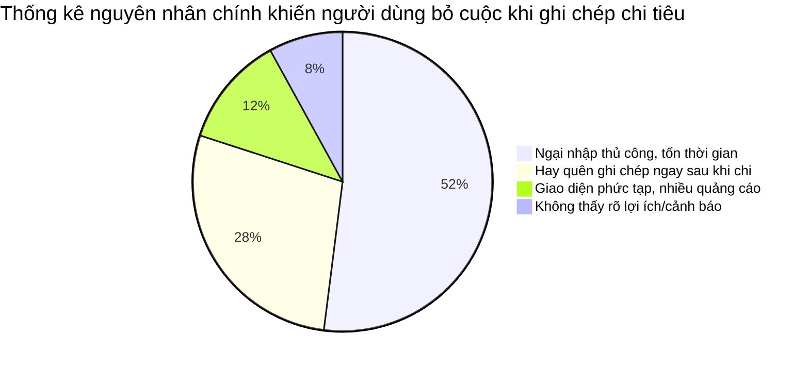
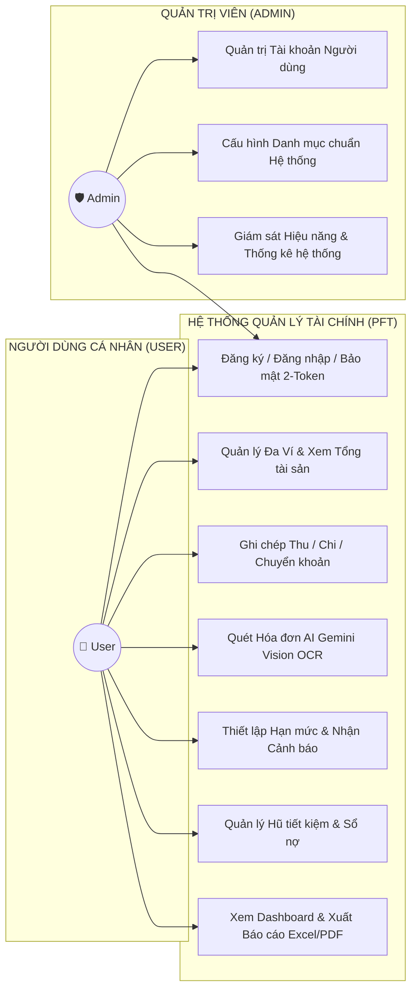

# 📑 BÁO CÁO KHẢO SÁT HIỆN TRẠNG, NGHIÊN CỨU THỊ TRƯỜNG VÀ ĐÁNH GIÁ TÍNH KHẢ THI
## ĐỀ TÀI: NỀN TẢNG QUẢN LÝ TÀI CHÍNH CÁ NHÂN THÔNG MINH (SMART PERSONAL FINANCE TRACKER - PFT)

---

| **Thông tin** | **Chi tiết** |
| :--- | :--- |
| **Loại tài liệu** | Báo cáo Khảo sát Giai đoạn Khởi tạo (Inception Survey & Feasibility Report) |
| **Học phần / Đồ án** | Đồ án Tốt nghiệp Kỹ sư / Cử nhân Công nghệ Thông tin |
| **Mã đề tài (Project Key)** | `PFT` (Personal Finance Tracker) |
| **Đối tượng khảo sát** | Sinh viên, Người đi làm trẻ (18 - 35 tuổi), Người dùng ứng dụng Fintech tại Việt Nam |
| **Thời gian khảo sát** | Tháng 10 / 2026 |
| **Công nghệ khảo sát** | Spring Boot 3 (Java 21), React 19 (TypeScript), MySQL 8 (InnoDB), Google Gemini AI |

---

## 🧭 MỤC LỤC BÁO CÁO KHẢO SÁT

1. [TỔNG QUAN VÀ BỐI CẢNH KHẢO SÁT](#1-tổng-quan-và-bối-cảnh-khảo-sát)
   - 1.1. Bối cảnh xã hội và xu hướng tài chính cá nhân
   - 1.2. Vấn đề thực tế (Pain Points) của người dùng
   - 1.3. Mục tiêu và phạm vi của đợt khảo sát
2. [KHẢO SÁT HIỆN TRẠNG VÀ PHÂN TÍCH ĐỐI THỦ (BENCHMARK ANALYSIS)](#2-khảo-sát-hiện-trạng-và-phân-tích-đối-thủ-benchmark-analysis)
   - 2.1. Khảo sát các phương pháp truyền thống
   - 2.2. Khảo sát các ứng dụng hiện có trên thị trường
   - 2.3. Ma trận đối chuẩn tính năng (Feature Comparison Matrix)
   - 2.4. Khoảng trống thị trường và Lợi thế của đề tài
3. [KẾT QUẢ KHẢO SÁT NGƯỜI DÙNG THỰC TẾ (USER RESEARCH)](#3-kết-quả-khảo-sát-người-dùng-thực-tế-user-research)
   - 3.1. Phương pháp và mẫu khảo sát
   - 3.2. Số liệu thống kê và phân tích kết quả
   - 3.3. Xây dựng Chân dung người dùng (User Personas)
4. [KHẢO SÁT CÔNG NGHỆ VÀ TÍNH KHẢ THI KỸ THUẬT](#4-khảo-sát-công-nghệ-và-tính-khả-thi-kỹ-thuật)
   - 4.1. Khảo sát Backend: Spring Boot 3 (Java 21)
   - 4.2. Khảo sát Frontend: React 19 + TypeScript + Tailwind CSS
   - 4.3. Khảo sát Cơ sở dữ liệu: MySQL 8 chuẩn ACID
   - 4.4. Khảo sát Giải pháp AI: Google Gemini Multimodal Vision
5. [TỔNG HỢP YÊU CẦU HỆ THỐNG TỪ KẾT QUẢ KHẢO SÁT](#5-tổng-hợp-yêu-cầu-hệ-thống-từ-kết-quả-khảo-sát)
   - 5.1. Yêu cầu chức năng (Functional Requirements - FR)
   - 5.2. Yêu cầu phi chức năng (Non-Functional Requirements - NFR)
   - 5.3. Sơ đồ Use Case tổng quát
6. [KẾT LUẬN KHẢO SÁT VÀ ĐỀ XUẤT GIẢI PHÁP](#6-kết-luận-khảo-sát-và-đề-xuất-giải-pháp)

---

## 1. TỔNG QUAN VÀ BỐI CẢNH KHẢO SÁT

### 1.1. Bối cảnh xã hội và xu hướng tài chính cá nhân
Trong những năm gần đây, nền kinh tế số tại Việt Nam ghi nhận sự phát triển vượt bậc về thanh toán không dùng tiền mặt (Cashless Payment). Theo thống kê từ Ngân hàng Nhà nước và các tổ chức nghiên cứu thị trường:
- Tỷ lệ người trưởng thành tại Việt Nam sở hữu ít nhất 1 tài khoản ngân hàng đạt trên **87%**.
- Một người trẻ (18 - 35 tuổi) trung bình sở hữu từ **2 đến 4 kênh thanh toán**: Tài khoản ngân hàng (VIB, Vietcombank, Techcombank...), ví điện tử (MoMo, ZaloPay, ShopeePay), tiền mặt và thẻ tín dụng (Credit Card).
- Thói quen mua sắm trực tuyến (E-commerce), đặt đồ ăn (Food Delivery), thanh toán QR Code phát sinh hàng chục giao dịch vi mô (micro-transactions) mỗi ngày.

### 1.2. Vấn đề thực tế (Pain Points) của người dùng
Dù dòng tiền vận hành liên tục, đa số người dùng trẻ đang đối mặt với những vấn đề nghiêm trọng:
1. **Phân mảnh tài sản (Fragmentation):** Tiền nằm rải rác ở nhiều ví, ngân hàng khiến người dùng không nắm được chính xác mình đang có tổng cộng bao nhiêu tiền trong thời gian thực.
2. **Hội chứng "Viêm màng túi cuối tháng" (End-of-Month Deficit):** Thu nhập ổn định nhưng luôn hết tiền vào cuối tháng mà không giải thích được tiền đã chi vào danh mục nào.
3. **Rào cản nhập liệu thủ công (Manual Logging Burden):** Đây là **nguyên nhân số 1** khiến người dùng từ bỏ việc quản lý tài chính. Sau khi mua sắm hoặc ăn uống, việc mở app, gõ từng con số, chọn danh mục, chọn ví quá tốn thời gian.
4. **Thiếu cơ chế cảnh báo chủ động:** Các công cụ hiện tại chỉ ghi chép thụ động, không kịp thời cảnh báo khi người dùng sắp chạm ngưỡng hạn mức ngân sách tháng.

### 1.3. Mục tiêu và phạm vi của đợt khảo sát
- **Mục tiêu:**
  - Khảo sát toàn diện thói quen, khó khăn và nhu cầu quản lý chi tiêu của người dùng thực tế.
  - Phân tích ưu/nhược điểm của các giải pháp hiện hành trên thị trường.
  - Khảo sát các công nghệ phần mềm và trí tuệ nhân tạo (AI) hiện đại để chứng minh tính khả thi kỹ thuật.
  - Chốt danh sách yêu cầu nghiệp vụ (SRS) chuẩn hóa làm đầu vào cho giai đoạn thiết kế và xây dựng hệ thống.
- **Phạm vi khảo sát:**
  - Nghiệp vụ: Quản lý đa ví, Sổ cái thu/chi/chuyển khoản, Ngân sách hạn mức, Hũ tiết kiệm, Sổ nợ, Báo cáo trực quan và Tự động hóa bằng AI OCR.
  - Nền tảng: Ứng dụng Web Fullstack chuẩn Responsive (tối ưu hiển thị hoàn hảo trên cả Desktop và Smartphone).

---

## 2. KHẢO SÁT HIỆN TRẠNG VÀ PHÂN TÍCH ĐỐI THỦ (BENCHMARK ANALYSIS)

### 2.1. Khảo sát các phương pháp truyền thống
| Phương pháp | Ưu điểm | Nhược điểm / Rủi ro lớn | Kết luận đánh giá |
| :--- | :--- | :--- | :--- |
| **Sổ tay vật lý** | Dễ bắt đầu, không phụ thuộc công nghệ, bảo mật tuyệt đối cục bộ. | Phải cộng trừ thủ công; dễ thất lạc hoặc hư hỏng; không vẽ được biểu đồ; không thể tra cứu nhanh lịch sử theo từ khóa. | **Không còn phù hợp** với nhịp sống số hiện đại. |
| **Excel / Google Sheets** | Tùy biến công thức cao; vẽ biểu đồ tùy thích; lưu trữ đám mây. | Trải nghiệm trên điện thoại rất kém; dễ gõ nhầm phá vỡ công thức; giao diện khô khan; **100% nhập liệu thủ công** tốn nhiều công sức. | Chỉ phù hợp với người có chuyên môn kế toán hoặc kiên trì cao. |

### 2.2. Khảo sát các ứng dụng hiện có trên thị trường

#### 1. Money Lover
- **Mô tả:** Ứng dụng tài chính cá nhân phổ biến hàng đầu tại Việt Nam.
- **Ưu điểm:** Tính năng phong phú, có hỗ trợ liên kết một số ngân hàng, giao diện tiếng Việt.
- **Nhược điểm:**
  - Phiên bản miễn phí xuất hiện quá nhiều quảng cáo che màn hình gây khó chịu.
  - Tính năng tự động đọc ngân hàng thường xuyên gián đoạn do chính sách bảo mật thay đổi của ngân hàng.
  - Chi phí bản quyền gói trả phí (Premium) khá cao so với sinh viên và người có thu nhập trung bình.
  - Chưa khai thác triệt để sức mạnh của Generative AI (LLM) để hiểu ngữ cảnh hóa đơn.

#### 2. Sổ Thu Chi MISA
- **Mô tả:** Sản phẩm của công ty phần mềm MISA, tập trung vào hộ gia đình và tiểu thương.
- **Ưu điểm:** Nghiệp vụ kế toán chuẩn chỉ, báo cáo chi tiết theo chuẩn Việt Nam.
- **Nhược điểm:**
  - Giao diện mang hơi hướng phần mềm kế toán doanh nghiệp, khá phức tạp và khô cứng với người trẻ.
  - Thao tác ghi chép qua nhiều bước form rườm rà.
  - Thiếu tính linh hoạt trong quản lý đa nguồn tiền hiện đại và tính năng quét hóa đơn tự động.

#### 3. Spendee / Wallet by BudgetBakers
- **Mô tả:** Các ứng dụng quản lý chi tiêu nổi tiếng toàn cầu.
- **Ưu điểm:** Thiết kế giao diện (UI/UX) hiện đại, biểu đồ đẹp mắt.
- **Nhược điểm:**
  - Không tối ưu hóa danh mục cho văn hóa chi tiêu của người Việt (các khoản như hiếu hỉ, cà phê vỉa hè, giỗ chạp...).
  - Kết nối ngân hàng tại Việt Nam hầu như không hoạt động ổn định.
  - Giá thành gói dịch vụ đắt (tính bằng USD).

### 2.3. Ma trận đối chuẩn tính năng (Feature Comparison Matrix)

| Tiêu chí so sánh | Sổ tay / Excel | Money Lover (Free) | Sổ Thu Chi MISA | Spendee / Wallet | **Đề tài PFT (Đề xuất)** |
| :--- | :---: | :---: | :---: | :---: | :---: |
| **Quản lý đa ví (Tiền mặt, Bank, MoMo)** | Thủ công | Có (giới hạn ví) | Có | Có (giới hạn ví) | **Có (Không giới hạn, thời gian thực)** |
| **Bảo toàn số dư chuẩn ACID** | Không | Đôi khi lệch | Có | Có | **Có (DECIMAL 19,4 & BigDecimal)** |
| **Cảnh báo vượt hạn mức ngân sách** | Không | Có (cơ bản) | Có | Có | **Có (Ngưỡng vàng 80% & đỏ 100%)** |
| **AI Quét hóa đơn tự bóc tách JSON** | Không | Không | Không | Quét OCR thường (hay lỗi) | **Có (Gemini Vision bóc tách tự động)** |
| **Nhập liệu bằng văn tự nhiên (NLP)** | Không | Không | Không | Không | **Có (Nhập câu văn tự điền form)** |
| **Cơ chế bảo mật 2-Token (JWT Rotation)** | Không | Phụ thuộc App | Phụ thuộc App | Phụ thuộc App | **Có (Access Token 15p + HttpOnly Cookie)** |
| **Trải nghiệm không quảng cáo** | Có | ❌ Nhiều quảng cáo | ❌ Có quảng cáo | ❌ Nhiều quảng cáo | **100% Sạch sẽ, tập trung trải nghiệm** |
| **Khả năng tự chủ dữ liệu & Mã nguồn mở** | Cục bộ | Đóng kín | Đóng kín | Đóng kín | **Toàn quyền phát triển và mở rộng** |

### 2.4. Khoảng trống thị trường và Lợi thế của đề tài
Qua khảo sát đối chuẩn, đề tài xác định được **3 khoảng trống lớn** mà các sản phẩm trên thị trường chưa giải quyết trọn vẹn:
1. **Rào cản thời gian nhập liệu:** Đề tài ứng dụng **Spring AI kết hợp Google Gemini Vision**, cho phép người dùng chỉ cần chụp hóa đơn (siêu thị, quán ăn, nhà thuốc) hoặc dán ảnh chụp màn hình chuyển khoản, hệ thống sẽ tự động bóc tách: *Số tiền, Danh mục, Thời gian, Tên nhà cung cấp* và điền form tức thì.
2. **Tính chính xác và minh bạch tài chính:** Áp dụng tiêu chuẩn kế toán nghiêm ngặt: Chuyển tiền giữa các ví theo chuẩn ACID (Rollback nếu lỗi), lưu trữ số thập phân chính xác bằng `DECIMAL(19, 4)` và `BigDecimal` để không bao giờ xảy ra lỗi làm tròn tiền.
3. **Bảo mật và quyền riêng tư:** Ứng dụng cơ chế bảo mật xác thực 2-Token (Access Token thời gian sống ngắn 15 phút, Refresh Token Rotation lưu trong `HttpOnly Secure Cookie`), bảo vệ tuyệt đối dữ liệu tài chính nhạy cảm của người dùng.

---

## 3. KẾT QUẢ KHẢO SÁT NGƯỜI DÙNG THỰC TẾ (USER RESEARCH)

### 3.1. Phương pháp và mẫu khảo sát
- **Hình thức thực hiện:** Bảng câu hỏi khảo sát trực tuyến (Google Forms) kết hợp phỏng vấn sâu 10 cá nhân tiêu biểu.
- **Quy mô mẫu khảo sát:** **150 người tham gia hợp lệ**.
- **Cơ cấu đối tượng tham gia:**
  - Độ tuổi: 18 – 22 tuổi (42% - Sinh viên các trường Đại học), 23 – 30 tuổi (45% - Nhân viên văn phòng, lập trình viên, kinh doanh), 31 – 35 tuổi (13% - Người có gia đình).
  - Thu nhập hàng tháng: Dưới 5 triệu (35%), từ 5 – 15 triệu (43%), trên 15 triệu (22%).

### 3.2. Số liệu thống kê và phân tích kết quả

#### Các số liệu khảo sát quan trọng nhất:
1. **Về thói quen thanh toán:**
   - **94.7%** thường xuyên thanh toán qua quét mã VietQR và ví điện tử (MoMo, ZaloPay).
   - **81.3%** sử dụng từ **2 tài khoản ngân hàng / ví điện tử trở lên** để quản lý tiền.
2. **Về việc theo dõi thu chi:**
   - **86.7%** người được hỏi từng cố gắng ghi chép thu chi cá nhân.
   - **Tuy nhiên, có tới 82.3% thừa nhận đã bỏ cuộc chỉ sau 1 đến 2 tuần đầu tiên.**
   - **Nguyên nhân chính:** 52% cho biết "ngại nhập liệu thủ công từng khoản nhỏ", 28% "hay quên ghi chép và làm mất hóa đơn".
3. **Về nhu cầu tính năng đột phá:**
   - **88.7%** đánh giá tính năng **"Chụp ảnh hóa đơn tự nhận diện số tiền và danh mục"** là tính năng cực kỳ hữu ích và sẽ giúp họ duy trì việc ghi chép lâu dài.
   - **91.3%** mong muốn có **cơ chế cảnh báo ngân sách tự động** khi chi tiêu vượt ngưỡng 80% hạn mức tháng.
   - **76.0%** có nhu cầu theo dõi các mục tiêu tiết kiệm (mua laptop, quỹ du lịch, quỹ khẩn cấp) và quản lý sổ nợ/cho vay.

### 3.3. Xây dựng Chân dung người dùng (User Personas)

#### 👤 Persona 1: Nguyễn Thành Nam – Sinh viên năm cuối (22 tuổi)
- **Bối cảnh:** Nhận trợ cấp từ gia đình và làm thêm với thu nhập khoảng 5 - 6 triệu/tháng.
- **Hành vi:** Dùng MoMo mua đồ ăn vặt, Techcombank trả tiền nhà, ShopeePay mua sắm online.
- **Nỗi đau (Pain points):** Thường xuyên hết tiền vào ngày 20 hàng tháng mà không rõ nguyên nhân. Rất lười mở app gõ từng khoản 20k - 30k.
- **Kỳ vọng vào hệ thống:** Giao diện đơn giản trên điện thoại; chụp ảnh hóa đơn cơm trưa/siêu thị là xong; có cảnh báo khi sắp hết tiền hạn mức.

#### 👤 Persona 2: Trần Thị Mai – Nhân viên văn phòng (26 tuổi)
- **Bối cảnh:** Thu nhập cố định 18 triệu/tháng, quản lý dòng tiền gia đình nhỏ.
- **Hành vi:** Chi tiêu thẻ tín dụng để tích điểm, gửi tiết kiệm online, chi tiêu sinh hoạt bằng QR code.
- **Nỗi đau (Pain points):** Khó theo dõi nợ thẻ tín dụng; số dư nằm rải rác 3 ngân hàng nên không biết tổng tài sản ròng thực tế; muốn tiết kiệm tiền đi du lịch nhưng thường bị thâm hụt.
- **Kỳ vọng vào hệ thống:** Quản lý đa ví trên một màn hình Dashboard duy nhất; có hũ tiết kiệm mục tiêu; xuất được file Excel sao kê chi tiết cuối tháng.

#### 👤 Persona 3: Lê Hoàng Long – Freelancer / Lập trình viên tự do (28 tuổi)
- **Bối cảnh:** Thu nhập không cố định theo tháng, phát sinh nhiều khoản nợ cần đòi và chi phí mua thiết bị làm việc.
- **Hành vi:** Giao dịch liên tục cả ngày, cần công cụ chuyên nghiệp, tốc độ xử lý nhanh, bảo mật cao.
- **Nỗi đau (Pain points):** Quên mất ai đang nợ tiền mình và mình đang nợ ai; ứng dụng cũ có quá nhiều quảng cáo rác làm gián đoạn công việc.
- **Kỳ vọng vào hệ thống:** Sổ nợ/cho vay rõ ràng; giao diện không quảng cáo; tốc độ phản hồi dưới 500ms; bảo mật tài khoản an toàn tuyệt đối.

---

## 4. KHẢO SÁT CÔNG NGHỆ VÀ TÍNH KHẢ THI KỸ THUẬT

### 4.1. Khảo sát Backend: Java 21 & Spring Boot 3
- **Lý do lựa chọn:**
  - Java 21 mang đến hiệu năng vượt trội với **Virtual Threads (Project Loom)**, xử lý hàng nghìn request đồng thời với mức tiêu tốn tài nguyên cực thấp.
  - Spring Boot 3 là nền tảng tiêu chuẩn công nghiệp (Enterprise-grade) với hệ sinh thái bảo mật **Spring Security 6**, hỗ trợ **OAuth2 Resource Server** và cơ chế **JWT Stateless**.
  - Xử lý nghiệp vụ tiền tệ chính xác tuyệt đối nhờ thư viện cốt lõi `java.math.BigDecimal`, loại bỏ hoàn toàn lỗi Floating Point Arithmetic của các ngôn ngữ như JavaScript/Python.
  - Tích hợp chính thức thư viện **Spring AI**, cho phép kết nối trực tiếp với các mô hình AI tiên tiến mà không cần thông qua middleware trung gian phức tạp.

### 4.2. Khảo sát Frontend: React 19 + TypeScript + Vite + Tailwind CSS v4
- **Lý do lựa chọn:**
  - **React 19:** Tận dụng React Compiler tối ưu render tự động, Server Components và các Action Hooks mới giúp tăng tốc độ tải trang.
  - **TypeScript:** Định kiểu tĩnh chặt chẽ (Strict Type-Safety), ngăn ngừa lỗi runtime trong quá trình tính toán hiển thị tài chính.
  - **Tailwind CSS v4:** Biên dịch CSS siêu tốc độ (Lightning CSS), hỗ trợ thiết kế Responsive đa nền tảng (Mobile-first) mượt mà chuẩn PWA.
  - **Thư viện đồ họa Recharts & Lucide Icons:** Cung cấp hệ thống biểu đồ Donut Chart, Area Chart chuyên nghiệp và hệ thống icon trực quan cho danh mục thu chi.

### 4.3. Khảo sát Cơ sở dữ liệu: MySQL 8 (InnoDB Engine)
- **Lý do lựa chọn:**
  - Hệ quản trị cơ sở dữ liệu quan hệ (RDBMS) vững chắc, tuân thủ nghiêm ngặt 4 nguyên lý **ACID (Atomicity, Consistency, Isolation, Durability)**.
  - Hỗ trợ kiểu dữ liệu tiền tệ tiêu chuẩn `DECIMAL(19, 4)` bảo toàn chính xác số dư ví và giao dịch.
  - Cơ chế **Foreign Key Constraints** và Transaction Management đảm bảo khi xóa danh mục hoặc sửa giao dịch cũ thì số dư ví được hoàn nguyên (Rollback) toàn vẹn, không sinh ra dữ liệu rác.

### 4.4. Khảo sát Giải pháp AI: Google Gemini Multimodal Vision
| Công nghệ AI | Độ chính xác trên hóa đơn tiếng Việt | Tốc độ xử lý | Khả năng bóc tách JSON cấu trúc | Đánh giá tính khả thi |
| :--- | :---: | :---: | :---: | :--- |
| **Tesseract OCR (Mã nguồn mở)** | Kém (~55%) | Nhanh | ❌ Không (chỉ ra chuỗi ký tự thô, phải viết hàng trăm quy tắc Regex) | Không khả thi với hóa đơn thực tế |
| **Google Cloud Vision OCR thuần** | Khá (~85%) | Nhanh | ❌ Không (chỉ nhận diện tọa độ chữ, không hiểu đâu là tổng tiền, đâu là VAT) | Tốn chi phí, tốn công lập trình bóc tách |
| **Google Gemini 1.5/2.0 Flash (Multimodal)** | **Xuất sắc (~96%)** | **Rất nhanh (1.5 - 2s)** | **Định dạng trực tiếp chuẩn JSON (Total amount, Category, Date, Merchant)** | **LỰA CHỌN TỐI ƯU NHẤT CHO ĐỀ TÀI** |

---

## 5. TỔNG HỢP YÊU CẦU HỆ THỐNG TỪ KẾT QUẢ KHẢO SÁT

Từ các số liệu khảo sát thị trường và người dùng, hệ thống được quy chuẩn thành các nhóm yêu cầu sau:

### 5.1. Yêu cầu chức năng (Functional Requirements - FR)
- **FR-1 (Xác thực & Danh tính):** Đăng ký, đăng nhập, bảo vệ phiên bằng cơ chế 2-Token (Access Token 15 phút, Refresh Token Rotation 7 ngày trong HttpOnly Cookie), đổi mật khẩu, xem hồ sơ cá nhân.
- **FR-2 (Quản lý Đa Ví):** Tạo và quản lý nhiều ví tiền (Tiền mặt, Ngân hàng, Ví điện tử, Thẻ tín dụng); cập nhật số dư; chuyển đổi trạng thái "Tính vào tổng tài sản".
- **FR-3 (Phân loại & Danh mục):** Cung cấp bộ danh mục Thu/Chi mặc định có màu sắc và icon trực quan; cho phép người dùng tự tạo danh mục riêng biệt.
- **FR-4 (Sổ cái Giao dịch ACID):** Ghi nhận Thu tiền, Chi tiền, Chuyển khoản nội bộ giữa 2 ví; tự động cộng/trừ số dư ví tức thời; hỗ trợ hoàn tác số dư khi chỉnh sửa hoặc xóa giao dịch.
- **FR-5 (Hạn mức Ngân sách & Cảnh báo):** Thiết lập ngân sách chi tiêu tối đa theo tháng cho từng danh mục; hệ thống tự động tính toán tiến độ và kích hoạt cảnh báo vàng (80%) và cảnh báo đỏ (100%).
- **FR-6 (Tích lũy & Công nợ):** Tạo các hũ tiết kiệm mục tiêu (tỷ lệ hoàn thành %); tạo sổ theo dõi Nợ cần trả và Khoản cho vay cần thu hồi.
- **FR-7 (Thống kê & Xuất báo cáo):** Biểu đồ cơ cấu chi tiêu Donut Chart, biểu đồ dòng tiền thu-chi; trích xuất dữ liệu ra file Excel (.xlsx) và file PDF sao kê.
- **FR-8 (Trí tuệ nhân tạo AI OCR):** Upload ảnh hóa đơn mua hàng, Gemini Vision tự động phân tích và trả về thông tin giao dịch để người dùng xác nhận chỉ với 1 click.

### 5.2. Yêu cầu phi chức năng (Non-Functional Requirements - NFR)
- **NFR-1 (Hiệu năng):** Thời gian phản hồi của các API nghiệp vụ CRUD dưới **300ms**; API xử lý AI OCR dưới **3 giây**.
- **NFR-2 (Bảo mật & Toàn vẹn):** Mật khẩu mã hóa BCrypt (độ phức tạp 10); phòng chống XSS bằng HttpOnly Cookie; phòng chống race condition trong giao dịch bằng Transactional Lock.
- **NFR-3 (Trải nghiệm người dùng - UX):** Thiết kế chuẩn Mobile-first Responsive, người dùng có thể thao tác thuận tiện bằng 1 tay trên điện thoại di động; thời gian hoàn thành 1 giao dịch thủ công dưới **10 giây**, qua AI dưới **3 giây**.
- **NFR-4 (Tính khả dụng):** Đóng gói Containerization bằng Docker và Docker Compose, dễ dàng triển khai và sao lưu.

### 5.3. Sơ đồ Use Case tổng quát dựa trên kết quả khảo sát

---

## 6. KẾT LUẬN KHẢO SÁT VÀ ĐỀ XUẤT GIẢI PHÁP

### 6.1. Đánh giá tính khả thi tổng thể
1. **Tính khả thi về mặt thực tiễn (Practical Feasibility):** Nhu cầu kiểm soát dòng tiền và mong muốn tự động hóa việc nhập liệu là bài toán thực tế cấp thiết của hàng triệu người dùng trẻ tại Việt Nam. Đề tài đánh trúng nỗi đau lớn nhất (rào cản lười nhập liệu) bằng giải pháp AI.
2. **Tính khả thi về mặt kỹ thuật (Technical Feasibility):** Các công nghệ được khảo sát (Java 21, Spring Boot 3, React 19, MySQL 8, Gemini API) đều là các nền tảng tiên tiến, có tài liệu phong phú, cộng đồng lớn, hỗ trợ xử lý dữ liệu tài chính chính xác và bảo mật.
3. **Tính khả thi về thời gian (Schedule Feasibility):** Đề tài được phân rã thành **6 Sprints (12 tuần - 152 Story Points)** theo chuẩn Agile/Scrum, với phạm vi vừa vặn để một sinh viên/nhóm sinh viên hoàn thành xuất sắc đồ án tốt nghiệp.

### 6.2. Đề xuất định hướng triển khai
- **Giai đoạn tiếp theo:** Chuyển giao toàn bộ kết quả khảo sát sang bước **Thiết kế chi tiết Hệ thống**:
  - Thiết kế Lược đồ quan hệ thực thể (ERD) chi tiết gồm 10 bảng nghiệp vụ.
  - Thiết kế Kiến trúc phân tầng Clean Architecture cho Spring Boot Backend và React Frontend.
  - Chuẩn hóa bộ API Endpoints và triển khai Sprint 1 (Xác thực 2-Token & Quản lý Đa Ví).
