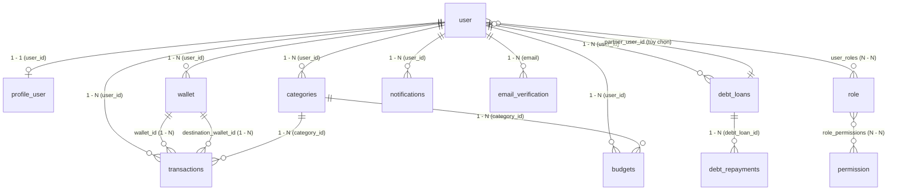

# DANH MỤC THỰC THỂ & CƠ SỞ DỮ LIỆU (DATABASE SCHEMA & ERD)
**Dự án:** Nền tảng Quản lý Tài chính Cá nhân Thông minh (Smart Personal Finance Tracker - PFT)  
**Hệ quản trị CSDL:** MySQL 8.0 (InnoDB Engine)  
**Quy chuẩn tiền tệ:** `DECIMAL(19, 4)` & Java `BigDecimal`  
**Cơ chế khóa chính:** UUID (`VARCHAR(36)`) cho bảng dữ liệu, Chuỗi tự nhiên/JTI cho RBAC & Token  

---

## 1. BẢNG TỔNG HỢP CÁC BẢNG DỮ LIỆU THEO PHÂN HỆ

| STT | Tên Bảng (Table) | Khóa Chính (PK) | Loại Khóa | Mô Tả Vai Trò Nghiệp Vụ |
| :---: | :--- | :--- | :---: | :--- |
| **I** | **Phân hệ Người dùng & Bảo mật (Auth & RBAC)** | | | |
| 1 | `user` | `id` | VARCHAR(36) UUID | Lưu trữ tài khoản người dùng, email, username, mật khẩu mã hóa BCrypt, trạng thái hoạt động (`is_active`), phương thức đăng nhập (`NORMAL`/`GOOGLE`), cờ xác thực email (`is_email_verified`). |
| 2 | `profile_user` | `id` | VARCHAR(36) UUID | Hồ sơ mở rộng của người dùng: ảnh đại diện (`avatar_url`), tiểu sử (`bio`), ngày tạo/cập nhật. Liên kết 1 - 1 với bảng `user`. |
| 3 | `role` | `name` | VARCHAR(255) Tự nhiên | Lưu danh mục vai trò người dùng trong hệ thống (`ROLE_USER`, `ROLE_ADMIN`). |
| 4 | `permission` | `name` | VARCHAR(255) Tự nhiên | Lưu danh mục quyền hạn chi tiết trong hệ thống (ví dụ: `CREATE_TRANSACTION`, `MANAGE_USERS`, `VIEW_ALL_WALLETS`). |
| 5 | `user_roles` | `(user_id, roles_name)` | Composite Key | Bảng trung gian thể hiện quan hệ N - N giữa `user` và `role`. |
| 6 | `role_permissions` | `(role_name, permissions_name)` | Composite Key | Bảng trung gian thể hiện quan hệ N - N giữa `role` và `permission`. |
| 7 | `email_verification` | `id` | VARCHAR(36) UUID | Lưu trữ mã OTP 6 số, email nhận mã, thời gian hết hạn (`expiry_time`) và trạng thái sử dụng (`is_used`) phục vụ kích hoạt tài khoản/đổi mật khẩu. |
| 8 | `invalidated_token` | `id` | VARCHAR(255) Chuỗi JTI | Danh sách đen (Blacklist) lưu trữ mã định danh (JTI) của Token cùng thời điểm hết hạn (`expiry_time`) khi người dùng Đăng xuất (Logout) hoặc khi Xoay vòng Refresh Token (Token Rotation). |
| **II** | **Phân hệ Tài chính Cốt lõi (Core Finance & Ledger)** | | | |
| 9 | `wallet` | `id` | VARCHAR(36) UUID | Quản lý các nguồn tiền/tài khoản (Tiền mặt, Ngân hàng, Ví điện tử, Thẻ tín dụng); lưu trữ số dư `balance` chuẩn `DECIMAL(19,4)`, cờ `include_in_total` và cờ xóa mềm `is_active`. |
| 10 | `categories` | `id` | VARCHAR(36) UUID | Phân loại giao dịch (Ăn uống, Tiền lương, Di chuyển...); phân loại `EXPENSE` hoặc `INCOME`; phân biệt danh mục mặc định hệ thống (`is_default=true`) và danh mục do user tự tạo. |
| 11 | `transactions` | `id` | VARCHAR(36) UUID | Sổ cái tài chính ghi nhận mọi giao dịch phát sinh (Thu, Chi, Chuyển khoản nội bộ giữa 2 ví). Lưu số tiền `amount` và ảnh chụp số dư ví ngay sau giao dịch (`balance_after`) để kiểm toán và vẽ biểu đồ dòng tiền. Có hỗ trợ xóa mềm (`is_deleted`). |
| 12 | `budgets` | `id` | VARCHAR(36) UUID | Lưu trữ kế hoạch/hạn mức chi tiêu tối đa theo tháng (`month`, `year`) cho từng danh mục (`category_id`). Chứa cờ đánh dấu đã gửi cảnh báo mốc 80% (`notified_at_80`) và mốc 100% (`notified_at_100`). |
| **III** | **Phân hệ Ghi nợ & Cho vay Song phương (Debt & Loan 2.0)** | | | |
| 13 | `debt_loans` | `id` | VARCHAR(36) UUID | Sổ theo dõi các khoản nợ (`DEBT`) hoặc cho vay (`LOAN`). Quản lý số tiền gốc (`amount`), số tiền còn lại (`remaining_amount`), thông tin ngân hàng nhận tiền để sinh mã VietQR thanh toán, và `linked_debt_loan_id` để đồng bộ tự động 2 chiều giữa 2 tài khoản đối tác. |
| 14 | `debt_repayments` | `id` | VARCHAR(36) UUID | Lịch sử chi tiết các đợt trả nợ từng phần/toàn phần cho từng khoản nợ trong `debt_loans`. |
| **IV** | **Phân hệ Thông báo & Cảnh báo (Notifications & Events)** | | | |
| 15 | `notifications` | `id` | VARCHAR(36) UUID | Lưu trữ thông báo gửi đến người dùng: Cảnh báo ngân sách (80%/100%), thông báo giao dịch, nhắc nợ định kỳ. Có trạng thái đọc (`is_read`) và đường dẫn điều hướng màn hình (`action_url`). Đánh chỉ mục hỗn hợp `(user_id, is_read, created_at)` để truy vấn siêu tốc. |

---

## 2. SƠ ĐỒ MỐI QUAN HỆ THỰC THỂ (ERD)

---

## 3. CÁC NGUYÊN TẮC THIẾT KẾ CƠ SỞ DỮ LIỆU ĐẶC BIỆT CỦA HỆ THỐNG
1. **Bảo toàn số dư tài chính (ACID)**: 
   - Số tiền trong `wallet`, `transactions`, `budgets`, `debt_loans`, `debt_repayments` luôn dùng kiểu `DECIMAL(19, 4)` để ngăn ngừa sai số làm tròn số học nhị phân.
2. **Cơ chế Soft-Delete (Xóa mềm)**:
   - Các bảng `wallet`, `categories`, `transactions`, `budgets`, `debt_loans` dùng trường `is_active` hoặc `is_deleted` để đảm bảo không đứt gãy lịch sử kiểm toán dòng tiền.
3. **Cơ chế Bảo mật Token Blacklist**:
   - Bảng `invalidated_token` lưu trữ các mã JTI có hạn dùng ngắn/dài đã đăng xuất hoặc bị thu hồi khi xoay vòng token (Refresh Token Rotation), giúp hệ thống Stateless nhưng vẫn kiểm soát thu hồi phiên tức thời.
