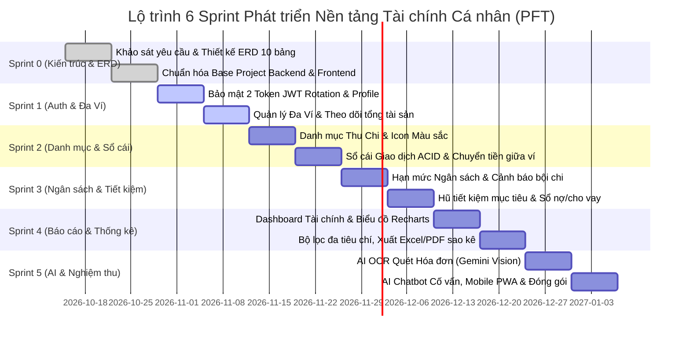

# 🎓 BÁO CÁO KẾ HOẠCH DỰ ÁN TRÊN JIRA — TỪ CON SỐ 0 (ZERO TO HERO)
## ĐỒ ÁN TỐT NGHIỆP: NỀN TẢNG QUẢN LÝ TÀI CHÍNH CÁ NHÂN THÔNG MINH (SMART PERSONAL FINANCE TRACKER)

> **Mã dự án (Project Key):** `PFT` (Personal Finance Tracker)  
> **Phương pháp luận phát triển:** Agile / Scrum Framework  
> **Tổng chu kỳ phát triển:** 6 Sprints (Sprint 0: Chuẩn bị & Kiến trúc; Sprint 1–5: Phát triển & Bàn giao)  
> **Thời lượng mỗi Sprint:** 2 tuần / Sprint (Tổng thời gian: 12 tuần chuẩn tiến độ đồ án)  
> **Tổng số Story Points:** 152 SP  
> **Các bên liên quan (Actors):**
> 1. 👤 `User (Người dùng cá nhân)`: Quản lý đa ví, ghi chép thu/chi/chuyển khoản, quét hóa đơn bằng AI, đặt hạn mức ngân sách, theo dõi hũ tiết kiệm, quản lý sổ nợ và xem báo cáo tài chính.
> 2. 🛡️ `Admin (Quản trị viên)`: Quản trị tài khoản người dùng, cấu hình bộ danh mục thu/chi mặc định của hệ thống, giám sát tình trạng hệ thống và thống kê tổng quan.

---

## 🗺️ TỔNG QUAN PHÂN RÃ SỬ THI (EPIC BREAKDOWN)

| Mã Epic | Tên Sử thi (Epic Name) | Mô tả mục tiêu | Tổng SP |
|---|---|---|:---:|
| **PFT-EPIC-0** | **Project Inception & Architecture** | Khảo sát yêu cầu, thiết kế ERD tài chính, kiến trúc phân tầng, setup chuẩn Clean Architecture | **14 SP** |
| **PFT-EPIC-1** | **Identity, Auth & Multi-Wallet Core** | Hoàn thiện bảo mật 2 Token JWT Rotation, Quản lý đa nguồn tiền (Tiền mặt, Ngân hàng, Ví điện tử) | **24 SP** |
| **PFT-EPIC-2** | **Category System & Core Ledger** | Hệ thống danh mục Thu/Chi phân cấp, Ghi nhận giao dịch và biến động số dư ví chuẩn ACID | **28 SP** |
| **PFT-EPIC-3** | **Budgeting, Savings & Debt Tracker** | Thiết lập hạn mức chi tiêu theo tháng, cảnh báo vượt ngưỡng 80%-100%, hũ tiết kiệm & sổ nợ/vay | **24 SP** |
| **PFT-EPIC-4** | **Analytics, Visualization & Export** | Dashboard tổng quan tài sản, biểu đồ cơ cấu chi tiêu (Donut/Bar chart), xuất báo cáo Excel & PDF sao kê | **22 SP** |
| **PFT-EPIC-5** | **AI Receipt OCR & Smart Advisor** | Tích hợp Spring AI (Gemini Vision) quét hóa đơn tự điền form, NLP nhập liệu tự nhiên & Cố vấn tài chính | **26 SP** |
| **PFT-EPIC-6** | **Optimization, Testing & Deployment** | Tối ưu giao diện Mobile Responsive, kiểm thử E2E, đóng gói Docker Compose và bàn giao đồ án | **14 SP** |

---

## 📅 LỘ TRÌNH TRIỂN KHAI THEO SPRINTS (SPRINT SCHEDULE)

---

## 📋 CHI TIẾT CÔNG VIỆC TỪNG SPRINT (SPRINT BACKLOG)

---

### 🚀 SPRINT 0: KHỞI TẠO DỰ ÁN & THIẾT KẾ HỆ THỐNG (Weeks 1 - 2)
> **Mục tiêu:** Hoàn thiện đặc tả yêu cầu phần mềm (SRS), thiết kế CSDL (ERD) cho bài toán tài chính, tinh chỉnh cấu hình Base Project Spring Boot và React 19.

#### 🎫 PFT-001: Khảo sát yêu cầu, Thiết kế ERD Tài chính & Kiến trúc hệ thống
- **Type:** Task | **Priority:** Highest | **SP:** 8 | **Sprint:** Sprint 0
- **Mô tả:** Thiết kế kiến trúc phân tầng Layered Architecture và lược đồ quan hệ thực thể (ERD) trên MySQL 8 gồm 10 bảng nghiệp vụ.
- **Kỹ thuật:**
  - Thiết kế ERD: `users`, `roles`, `user_roles`, `invalidated_tokens`, `wallets`, `categories`, `transactions`, `budgets`, `saving_goals`, `debts_loans`.
  - Quy ước kiểu dữ liệu tiền tệ bắt buộc: `DECIMAL(19, 4)` trên DB và `BigDecimal` trong Java.
  - Sơ đồ kiến trúc tổng thể, sơ đồ luồng dữ liệu (DFD), sơ đồ Use Case cho User và Admin.
- **AC:** Có đầy đủ tài liệu đặc tả kiến trúc và file sơ đồ ERD chuẩn quan hệ 1-1, 1-N, N-N.

#### 🎫 PFT-002: Chuẩn hóa Base Project Backend & Clean Configuration
- **Type:** Task | **Priority:** Highest | **SP:** 3 | **Sprint:** Sprint 0
- **Mô tả:** Dọn dẹp các tàn dư của dự án cũ trong Spring Boot, chuẩn hóa config `application.yaml` và `compose.yaml`.
- **Kỹ thuật:**
  - Cấu hình context-path chuẩn `/api`, đổi tên datasource sang `personal_finance`.
  - Cập nhật model AI: `gemini-1.5-flash`.
  - Mở các endpoint Swagger UI (`/swagger-ui/**`, `/v3/api-docs/**`) trong `SecurityConfig`.
- **AC:** Chạy ứng dụng thành công, Swagger UI load được tại `/api/swagger-ui/index.html`.

#### 🎫 PFT-003: Chuẩn hóa Base Project Frontend (React 19 + Vite + Tailwind v4)
- **Type:** Task | **Priority:** High | **SP:** 3 | **Sprint:** Sprint 0
- **Mô tả:** Cấu hình React 19, Tailwind CSS v4, Lucide Icons, Axios Interceptor đồng bộ với Backend mới.
- **Kỹ thuật:**
  - Cấu hình Axios Base URL trỏ đúng `/api`, gắn token tự động vào Request Header.
  - Tạo layout khung: Sidebar điều hướng, Header hiển thị thông tin User, vùng hiển thị nội dung chính.
- **AC:** Khung giao diện chính hiển thị mượt mà, hot-reload hoạt động tốt, không có lỗi console.

---

### 🛡️ SPRINT 1: XÁC THỰC BẢO MẬT & QUẢN LÝ ĐA VÍ (Weeks 3 - 4)
> **Mục tiêu:** Hoàn thiện cơ chế bảo mật 2 Token (Access Token & Refresh Token Rotation); Xây dựng nền tảng Đa Ví tiền (Multi-Wallet) để làm gốc quản lý dòng tiền.

#### 🎫 PFT-101: Cơ chế Bảo mật 2 Token (Access Token & Refresh Token Rotation)
- **Type:** Story | **Priority:** Highest | **SP:** 6 | **Sprint:** Sprint 1
- **User Story:** *"Là người dùng, tôi muốn đăng nhập an toàn, duy trì phiên làm việc mượt mà mà không lo bị đánh cắp phiên."*
- **Kỹ thuật:**
  - `BE`: Tách riêng Access Token (15 phút) và Refresh Token (7 ngày, lưu HttpOnly Cookie). Kiểm tra claim `token_type`. Mỗi lần refresh sẽ thu hồi (invalidate) Refresh Token cũ và cấp cặp mới (Rotation).
  - `FE`: Axios Interceptor đón lỗi 401, tự động gọi `/auth/refresh` và retry lại request cũ trong suốt quá trình người dùng sử dụng.
- **AC:** Đăng nhập trả về cả 2 token; Refresh token thành công tự cấp token mới; Logout xóa cookie và thu hồi token trong DB.

#### 🎫 PFT-102: Quản lý Hồ sơ Cá nhân & Đổi mật khẩu
- **Type:** Story | **Priority:** Medium | **SP:** 4 | **Sprint:** Sprint 1
- **User Story:** *"Là người dùng, tôi muốn cập nhật họ tên, ảnh đại diện và đổi mật khẩu khi cần thiết."*
- **Kỹ thuật:**
  - `BE`: API `GET /api/users/my-info`, `PUT /api/users/profile`, `PUT /api/users/change-password`. Validate mật khẩu cũ trước khi đổi.
  - `FE`: Trang `/profile`: Form đổi thông tin, đổi mật khẩu kèm validate độ mạnh mật khẩu (Zod).
- **AC:** Đổi mật khẩu thành công buộc người dùng phải đăng nhập lại trên các thiết bị khác.

#### 🎫 PFT-103: Quản lý Đa Ví tiền (Multi-Wallet Management)
- **Type:** Story | **Priority:** Highest | **SP:** 8 | **Sprint:** Sprint 1
- **User Story:** *"Là người dùng, tôi muốn tạo nhiều ví (Tiền mặt, Vietcombank, Momo) để quản lý từng nguồn tiền riêng biệt."*
- **Kỹ thuật:**
  - `BE`: Entity `Wallet` (`id`, `user_id`, `name`, `balance`, `currency`, `type`, `include_in_total`). API CRUD: `POST /api/wallets`, `GET /api/wallets`, `PUT`, `DELETE`.
  - `FE`: Màn hình `/wallets`: Danh sách thẻ ví thiết kế hiện đại (Card UI), màu sắc theo loại ví; Modal thêm mới/chỉnh sửa ví; Nút bật/tắt tính vào tổng tài sản.
- **AC:** Mỗi user có thể tạo nhiều ví; số dư ban đầu tính đúng vào tổng tài sản hiển thị.

#### 🎫 PFT-104: Widget Tổng Tài sản Thời gian thực trên Dashboard
- **Type:** Story | **Priority:** High | **SP:** 6 | **Sprint:** Sprint 1
- **User Story:** *"Là người dùng, tôi muốn thấy tổng số tiền mình đang có ngay khi vào trang chủ."*
- **Kỹ thuật:**
  - `BE`: API `GET /api/wallets/total-balance` (tính tổng `balance` các ví có `include_in_total = true`).
  - `FE`: Widget Hero Card ở đầu Dashboard: Hiển thị tổng tài sản (có nút icon con mắt để ẩn/hiện số dư bảo mật khi ở nơi công cộng).
- **AC:** Tổng số tiền bằng đúng tổng số dư các ví đang kích hoạt; ẩn/hiện số dư lưu trạng thái tạm thời.

---

### 🏷️ SPRINT 2: HỆ THỐNG DANH MỤC & SỔ CÁI GIAO DỊCH ACID (Weeks 5 - 6)
> **Mục tiêu:** Xây dựng danh mục Thu/Chi đa dạng có icon và màu sắc; Xây dựng Sổ cái Giao dịch (Ledger) đảm bảo toàn vẹn dữ liệu số dư ví khi có biến động thu/chi/chuyển khoản.

#### 🎫 PFT-201: Quản lý Danh mục Thu/Chi (Categories Management)
- **Type:** Story | **Priority:** Highest | **SP:** 7 | **Sprint:** Sprint 2
- **User Story:** *"Là người dùng, tôi muốn phân loại các khoản tiền theo danh mục (Ăn uống, Tiền nhà, Lương...) với icon và màu sắc dễ nhìn."*
- **Kỹ thuật:**
  - `BE`: Entity `Category` (`id`, `name`, `type`, `icon`, `color`, `is_default`, `user_id`). Khi tạo user mới, tự động khởi tạo bộ 15 danh mục mặc định chuẩn. API CRUD danh mục riêng của user.
  - `FE`: Màn hình `/categories`: Phân 2 tab "Khoản chi" (Đỏ/Cam) và "Khoản thu" (Xanh lá); Bộ chọn Icon và Color Picker trực quan.
- **AC:** User không được sửa/xóa danh mục mặc định hệ thống; danh mục tự tạo có thể chỉnh sửa tự do.

#### 🎫 PFT-202: Ghi nhận Giao dịch Thu & Chi (Transaction Core)
- **Type:** Story | **Priority:** Highest | **SP:** 8 | **Sprint:** Sprint 2
- **User Story:** *"Là người dùng, tôi muốn ghi chép nhanh một khoản thu hoặc chi, tiền trong ví tương ứng phải tự động tăng/giảm chính xác."*
- **Kỹ thuật:**
  - `BE`: Entity `Transaction` (`id`, `user_id`, `wallet_id`, `category_id`, `amount`, `type`, `transaction_date`, `note`, `image_url`).
  - `BE`: Nghiệp vụ `@Transactional`: 
    - Nếu `type = EXPENSE`: `wallet.balance = wallet.balance - amount`.
    - Nếu `type = INCOME`: `wallet.balance = wallet.balance + amount`.
  - `FE`: Modal "Thêm giao dịch nhanh" (+): Bàn phím số máy tính, chọn ví, chọn danh mục, chọn ngày giờ, ô ghi chú.
- **AC:** Số dư ví cập nhật tức thì; xóa/sửa giao dịch cũ sẽ tự động hoàn trả (rollback) số dư ví chính xác.

#### 🎫 PFT-203: Chuyển tiền giữa các Ví (Transfer Between Wallets)
- **Type:** Story | **Priority:** High | **SP:** 7 | **Sprint:** Sprint 2
- **User Story:** *"Là người dùng, tôi muốn ghi nhận việc rút tiền từ cây ATM hoặc chuyển khoản từ Ngân hàng sang ví Momo."*
- **Kỹ thuật:**
  - `BE`: Xử lý giao dịch `type = TRANSFER`: Kiểm tra ví nguồn $\rightarrow$ Trừ tiền ví nguồn $\rightarrow$ Cộng tiền ví đích. Toàn bộ logic chạy trong 1 Database Transaction duy nhất.
  - `FE`: Tab "Chuyển khoản" trong form giao dịch: Chọn Ví chuyển (Nguồn), Ví nhận (Đích), số tiền và phí chuyển (nếu có).
- **AC:** Ví nguồn giảm đúng số tiền, ví đích tăng đúng số tiền; tổng tài sản không bị sai lệch.

#### 🎫 PFT-204: Danh sách Lịch sử Giao dịch & Bộ lọc Nâng cao
- **Type:** Story | **Priority:** High | **SP:** 6 | **Sprint:** Sprint 2
- **User Story:** *"Là người dùng, tôi muốn xem lại danh sách chi tiêu và lọc theo ngày, theo ví hoặc theo danh mục."*
- **Kỹ thuật:**
  - `BE`: API `GET /api/transactions` hỗ trợ Phân trang (`Pageable`), lọc theo `walletId`, `categoryId`, `startDate`, `endDate`, tìm kiếm theo `note`. Đánh chỉ mục (Index) trên các cột lọc.
  - `FE`: Màn hình `/transactions`: Danh sách nhóm theo ngày (Hôm nay, Hôm qua, Tuần này); Thanh tìm kiếm nhanh và dropdown bộ lọc.
- **AC:** Tải dữ liệu nhanh dưới 100ms; hiển thị rõ ràng icon danh mục, tên ví và số tiền (+ xanh, - đỏ).

---

### 🎯 SPRINT 3: HẠN MỨC NGÂN SÁCH, TIẾT KIỆM & SỔ NỢ (Weeks 7 - 8)
> **Mục tiêu:** Xây dựng cơ chế kiểm soát chi tiêu bằng Ngân sách (Budget); Quản lý mục tiêu tích lũy tài chính (Saving Goals) và sổ theo dõi Nợ/Vay.

#### 🎫 PFT-301: Thiết lập Hạn mức Ngân sách theo Tháng (Budget Management)
- **Type:** Story | **Priority:** Highest | **SP:** 7 | **Sprint:** Sprint 3
- **User Story:** *"Là người dùng, tôi muốn đặt trần chi tiêu cho tháng này (VD: Ăn uống tối đa 3 triệu) để không bị tiêu hoang."*
- **Kỹ thuật:**
  - `BE`: Entity `Budget` (`id`, `user_id`, `category_id`, `limit_amount`, `month`, `year`). API kiểm tra tổng tiền đã chi của category đó trong tháng so với `limit_amount`.
  - `FE`: Màn hình `/budgets`: Danh sách ngân sách kèm thanh tiến trình (Progress Bar), hiển thị số tiền đã tiêu / số tiền còn lại / số ngày còn lại của tháng.
- **AC:** Tự động tính đúng phần trăm đã chi tiêu; nếu chi vượt ngân sách thanh đổi sang màu đỏ kèm nhãn "Đã vượt hạn mức".

#### 🎫 PFT-302: Hệ thống Cảnh báo Bội chi Ngưỡng 80% và 100%
- **Type:** Story | **Priority:** High | **SP:** 5 | **Sprint:** Sprint 3
- **User Story:** *"Là người dùng, tôi muốn nhận được cảnh báo ngay khi một khoản chi khiến tôi sắp chạm ngưỡng hoặc đã vượt ngân sách."*
- **Kỹ thuật:**
  - `BE`: Trong service tạo giao dịch, kiểm tra nếu `tiền đã chi / ngân sách >= 0.8` $\rightarrow$ Trả về cờ cảnh báo `budget_warning` trong Response.
  - `FE`: Toast notification (Sonner) hiển thị cảnh báo màu vàng khi chạm 80% và cảnh báo đỏ khẩn cấp khi vượt 100%.
- **AC:** Cảnh báo kích hoạt tức thì ngay sau khi lưu giao dịch vượt ngưỡng.

#### 🎫 PFT-303: Quản lý Mục tiêu Tiết kiệm (Saving Goals)
- **Type:** Story | **Priority:** High | **SP:** 6 | **Sprint:** Sprint 3
- **User Story:** *"Là người dùng, tôi muốn tạo các hũ tiết kiệm (Mua laptop, Quỹ du lịch) và nạp tiền vào dần dần."*
- **Kỹ thuật:**
  - `BE`: Entity `SavingGoal` (`id`, `name`, `target_amount`, `current_amount`, `target_date`, `status`). API nạp tiền: Trừ tiền từ ví chỉ định $\rightarrow$ Cộng vào `current_amount` của hũ tiết kiệm.
  - `FE`: Màn hình `/savings`: Hiển thị các hũ tiết kiệm dạng card trực quan; Modal "Gửi thêm tiền" hoặc "Rút tiền về ví".
- **AC:** Khi `current_amount >= target_amount` tự động chuyển trạng thái `COMPLETED` kèm hiệu ứng chúc mừng (Confetti).

#### 🎫 PFT-304: Sổ theo dõi Nợ & Cho Vay (Debts & Loans Tracker)
- **Type:** Story | **Priority:** Medium | **SP:** 6 | **Sprint:** Sprint 3
- **User Story:** *"Là người dùng, tôi muốn ghi chép xem ai đang nợ tiền tôi và tôi đang nợ ai để không bị quên."*
- **Kỹ thuật:**
  - `BE`: Entity `DebtLoan` (`id`, `person_name`, `type: DEBT/LOAN`, `amount`, `remaining_amount`, `due_date`, `status: UNPAID/PARTIAL/PAID`). API ghi nhận trả một phần hoặc trả hết nợ.
  - `FE`: Màn hình `/debts`: Danh sách phân tách rõ ràng "Tôi nợ" và "Nợ tôi"; Nút "Ghi nhận trả nợ" cập nhật nhanh số tiền còn lại.
- **AC:** Khi trả nợ hoàn tất chuyển trạng thái `PAID`; hỗ trợ lọc các khoản nợ đã quá hạn thanh toán.

---

### 📊 SPRINT 4: TRỰC QUAN HÓA DỮ LIỆU & BÁO CÁO SAO KÊ (Weeks 9 - 10)
> **Mục tiêu:** Xây dựng Dashboard phân tích tài chính chuyên sâu với các biểu đồ trực quan; Tích hợp tính năng xuất báo cáo sao kê ra file Excel và PDF.

#### 🎫 PFT-401: Biểu đồ Phân tích Cơ cấu Chi tiêu (Donut Chart)
- **Type:** Story | **Priority:** Highest | **SP:** 6 | **Sprint:** Sprint 4
- **User Story:** *"Là người dùng, tôi muốn nhìn biểu đồ tròn để biết phần lớn tiền của tôi tháng này đi vào đâu (Ăn uống hay Mua sắm)."*
- **Kỹ thuật:**
  - `BE`: API `GET /api/analytics/category-breakdown?month=&year=`: Truy vấn GROUP BY theo `category_id`, tính tổng tiền và tỷ lệ %.
  - `FE`: Tích hợp Recharts: Biểu đồ tròn Donut Chart hiển thị màu sắc theo từng danh mục, tooltip hiển thị số tiền và phần trăm khi hover.
- **AC:** Tổng phần trăm các danh mục bằng đúng 100%; click vào từng lát bánh sẽ lọc ra danh sách chi tiêu của danh mục đó.

#### 🎫 PFT-402: Biểu đồ Dòng tiền Thu vs Chi theo Thời gian (Cashflow Bar Chart)
- **Type:** Story | **Priority:** High | **SP:** 5 | **Sprint:** Sprint 4
- **User Story:** *"Là người dùng, tôi muốn so sánh tổng tiền kiếm được và tổng tiền tiêu qua các tháng để xem mình có đang tiết kiệm tốt không."*
- **Kỹ thuật:**
  - `BE`: API `GET /api/analytics/cashflow?year=`: Thống kê tổng Thu và Chi theo từng tháng trong năm.
  - `FE`: Biểu đồ cột kép (Grouped Bar Chart): Cột xanh (Thu nhập) đặt cạnh Cột đỏ (Chi tiêu) cho 12 tháng.
- **AC:** Biểu đồ phản ánh chính xác chênh lệch dòng tiền ròng (Net Income = Thu - Chi).

#### 🎫 PFT-403: Xuất Báo cáo Tài chính ra File Excel (.xlsx)
- **Type:** Story | **Priority:** High | **SP:** 6 | **Sprint:** Sprint 4
- **User Story:** *"Là người dùng, tôi muốn tải file Excel thống kê chi tiêu để tự lưu trữ hoặc phân tích thêm."*
- **Kỹ thuật:**
  - `BE`: Tích hợp thư viện **Apache POI**. Viết `ExcelExportService`: Tạo sheet danh sách giao dịch, sheet tổng hợp thu/chi, format số tiền, bôi màu tiêu đề chuyên nghiệp. API `GET /api/export/excel`.
  - `FE`: Nút "Xuất Excel" trên trang Báo cáo; xử lý tải blob file tự động đặt tên theo cú pháp `Bao-Cao-Tai-Chinh-[Thang-Nam].xlsx`.
- **AC:** File Excel mở được bằng Microsoft Excel / Google Sheets, công thức tính tổng chuẩn xác, không bị lỗi font tiếng Việt.

#### 🎫 PFT-404: Xuất Bản Sao Kê Thu Chi PDF (PDF Statement Generator)
- **Type:** Story | **Priority:** Medium | **SP:** 5 | **Sprint:** Sprint 4
- **User Story:** *"Là người dùng, tôi muốn xuất bản in sao kê PDF đẹp mắt để báo cáo tài chính cá nhân."*
- **Kỹ thuật:**
  - `BE`: Tích hợp thư viện **iText 7** hoặc **OpenPDF**. Thiết kế mẫu sao kê có logo, thông tin tài khoản, bảng danh sách giao dịch và chữ ký xác nhận. API `GET /api/export/pdf`.
  - `FE`: Nút "In sao kê PDF", mở hộp thoại xem trước (Preview) hoặc tải trực tiếp về máy.
- **AC:** File PDF render đúng chuẩn font Unicode tiếng Việt, bố cục canh lề chuẩn khổ giấy A4.

---

### 🤖 SPRINT 5: TRÍ TUỆ NHÂN TẠO AI & NGHIỆM THU ĐỒ ÁN (Weeks 11 - 12)
> **Mục tiêu:** Tích hợp tính năng đột phá: AI OCR đọc hóa đơn tự động điền form, Chatbot cố vấn tài chính thông minh; Kiểm thử E2E và đóng gói Docker bàn giao.

#### 🎫 PFT-501: AI OCR Quét Hóa đơn Mua sắm (Receipt Scanner with Gemini Vision)
- **Type:** Story | **Priority:** Highest | **SP:** 8 | **Sprint:** Sprint 5
- **User Story:** *"Là người dùng, tôi chỉ cần chụp ảnh bill tính tiền (siêu thị, nhà hàng), hệ thống tự đọc số tiền và danh mục mà không cần nhập tay."*
- **Kỹ thuật:**
  - `BE`: API `POST /api/ai/scan-receipt` (nhận ảnh MultipartFile). Tích hợp Spring AI gọi **Gemini 1.5/2.0 Flash Vision** với System Prompt định dạng JSON Schema: Trích xuất `totalAmount`, `date`, `merchantName`, `suggestedCategory`.
  - `FE`: Nút "Quét hóa đơn" trên Mobile/Desktop: Mở camera điện thoại hoặc upload ảnh; Modal hiển thị kết quả AI đọc được; Điền sẵn vào form tạo giao dịch.
- **AC:** Nhận diện đúng tổng tiền của hóa đơn rõ nét trong vòng dưới 3 giây; cho phép người dùng kiểm tra và chỉnh sửa trước khi lưu.

#### 🎫 PFT-502: Nhập Chi tiêu bằng Ngôn ngữ Tự nhiên (NLP Natural Expense Entry)
- **Type:** Story | **Priority:** High | **SP:** 6 | **Sprint:** Sprint 5
- **User Story:** *"Là người dùng, tôi muốn gõ hoặc nói câu: 'Vừa ăn phở 45k tiền mặt' là hệ thống tự hiểu và tạo giao dịch."*
- **Kỹ thuật:**
  - `BE`: API `POST /api/ai/parse-text`: Truyền câu text vào Gemini. AI bóc tách: `{ amount: 45000, category: 'Ăn uống', wallet: 'Tiền mặt', type: 'EXPENSE' }`.
  - `FE`: Thanh Quick Input ở đầu trang chủ có icon micro: Người dùng nhập văn bản hoặc nói qua Web Speech API $\rightarrow$ Hệ thống tự điền form.
- **AC:** Bóc tách chính xác số tiền viết tắt (VD: 45k, 100 cành, 1 triệu) và tự gán đúng ví/danh mục tương ứng.

#### 🎫 PFT-503: AI Chatbot Cố vấn Tài chính Cá nhân (Financial Advisor Bot)
- **Type:** Story | **Priority:** High | **SP:** 6 | **Sprint:** Sprint 5
- **User Story:** *"Là người dùng, tôi muốn trò chuyện với AI để xin lời khuyên: 'Tháng này tôi tiêu nhiều vào cái gì nhất và làm sao để tiết kiệm hơn?'."*
- **Kỹ thuật:**
  - `BE`: Tích hợp `AiConfig` (`ChatClient` + `MessageWindowChatMemory`). Truy vấn tổng hợp số liệu chi tiêu của user tháng hiện tại nhét vào Context Prompt để AI phân tích theo quy tắc tài chính chuẩn (50/30/20).
  - `FE`: Cửa sổ Chatbot nổi (Floating Chat Widget) góc phải màn hình; Giao diện tin nhắn thời gian thực có hiển thị trạng thái "AI đang suy nghĩ...".
- **AC:** AI trả lời thông minh dựa trên số liệu thực tế của chính người dùng, không trả lời lan man hoặc sai lệch.

#### 🎫 PFT-504: Tối ưu UI Mobile, Kiểm thử E2E & Đóng gói Docker Nghiệm thu
- **Type:** Task | **Priority:** Highest | **SP:** 6 | **Sprint:** Sprint 5
- **Mô tả:** Tối ưu hóa toàn bộ trải nghiệm người dùng trên màn hình điện thoại di động (PWA Responsive), kiểm thử toàn diện và đóng gói Docker chạy toàn bộ hệ thống.
- **Kỹ thuật:**
  - `FE`: Tinh chỉnh Tailwind CSS đảm bảo chuẩn Mobile-first, đáy màn hình có Bottom Navigation Bar thuận tiện cho thao tác ngón cái.
  - `DevOps`: Viết `Dockerfile` cho Backend & Frontend, cập nhật `compose.yaml` (chạy MySQL 8, Backend Spring Boot, Frontend Nginx).
  - Viết tài liệu báo cáo đồ án tốt nghiệp, chuẩn bị Slide thuyết trình và kịch bản Demo trực tiếp trước Hội đồng.
- **AC:** Chạy duy nhất lệnh `docker compose up -d` là toàn bộ hệ thống hoạt động hoàn hảo; Không có lỗi nghiêm trọng phát sinh trong kịch bản demo.

---

## 📈 TỔNG KẾT BÀN GIAO ĐỒ ÁN (DEFINITION OF DONE)
1. **Source Code**: Đạt chuẩn Clean Architecture, tách tầng Controller, Service, Repository, DTO, Mapper bài bản.
2. **Bảo mật**: Cơ chế 2-Token JWT Refresh Rotation, mã hóa mật khẩu BCrypt, phòng thủ XSS bằng HttpOnly Cookie.
3. **Toàn vẹn Dữ liệu**: Tất cả biến động tài chính chạy qua `@Transactional`, số dư tiền tệ lưu bằng `BigDecimal / DECIMAL(19,4)`.
4. **Điểm nhấn AI**: Hoạt động mượt mà với 3 tính năng: OCR quét hóa đơn, Nhập liệu NLP giọng nói/text, Chatbot cố vấn tài chính.
5. **Triển khai**: Đóng gói Docker hoàn chỉnh, tài liệu API Swagger OpenAPI đầy đủ.
